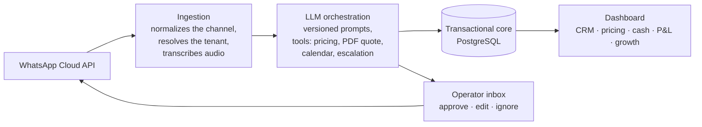

# Pitbull.ai

**The AI-native operating system for traditional SMEs: a WhatsApp sales agent, CRM, quotes, scheduling, cash and P&L on one core. Live at a home-safety company in Buenos Aires and Tucumán.**

The code is private: it runs a real business with real customer data. This page explains what it does and how it is built.

## What it does

- **WhatsApp sales copilot.** An LLM agent drafts every reply from the first message to the close: answers questions, reads photos of the space and voice notes, takes measurements, quotes, generates the PDF proposal and books the installation.
- **Human in the loop, autonomy earned stage by stage.** An operator approves, edits or ignores each draft from an inbox. Autonomy is switched on per stage of the funnel, only where a scorecard shows the agent gets it right (a draft the operator rewrites counts as an error). The goal is a fully autonomous agent that sells and books installations on its own.
- **Back office on the same core.** CRM, scheduling, pricing that the non-technical team edits without a deploy, cash and P&L, and a monthly growth tracker per city.
- **Multi-tenant from day one.** Every record belongs to a city, and each city has its own killswitch.

## First deployment

**Grupo Redes**, a home-safety SME (balcony safety nets) from Tucumán, Argentina. Pitbull.ai is its product and AI layer, and it is what let the business scale to Buenos Aires.

## Architecture

1. **Ingestion:** a webhook receives every message, normalizes it and resolves which city (tenant) it belongs to. Images and audio are handled too.
2. **LLM orchestration:** the agent reads the customer's history, decides what to answer and what to escalate to a person, and calls tools to quote, generate the proposal and book the visit.
3. **Transactional core:** one schema that the agent writes into. Every message, every model decision and the token cost of each call are logged.

## Principles

- Copilot before autonomous.
- A killswitch that turns the system off in seconds.
- Log everything, including what each model call costs.
- Tests for every piece of business logic: quoting, routing, agent decisions.

## Stack

Python · FastAPI · PostgreSQL · Railway · Claude API · Meta WhatsApp Cloud API · Whisper · Google Calendar · Next.js + Tailwind on Vercel · PWA with Web Push

## Built by

[Bautista Garzón](https://www.linkedin.com/in/bautistagarzon/), from zero, in 2026, with no prior coding background.
